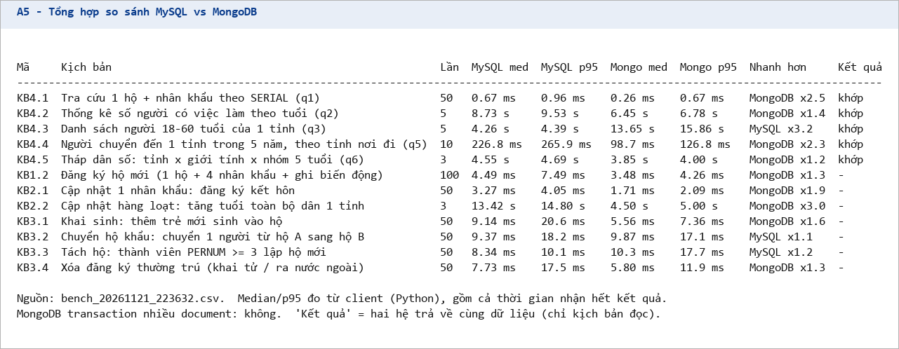
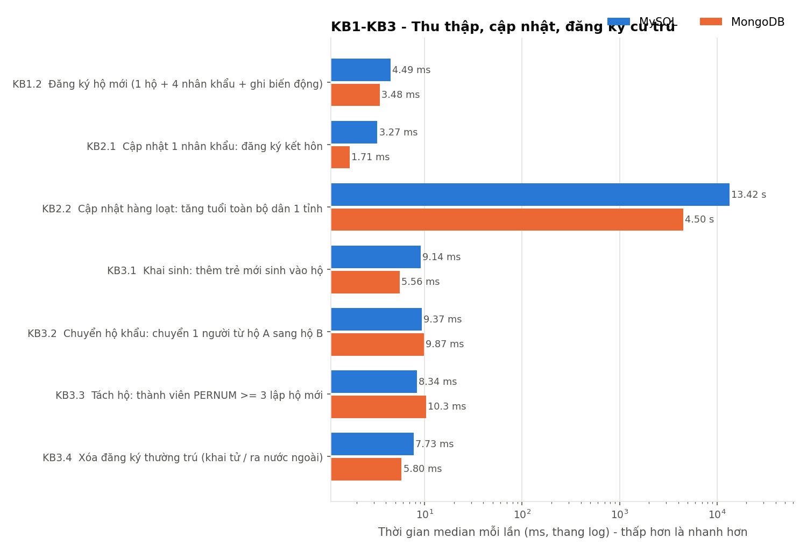
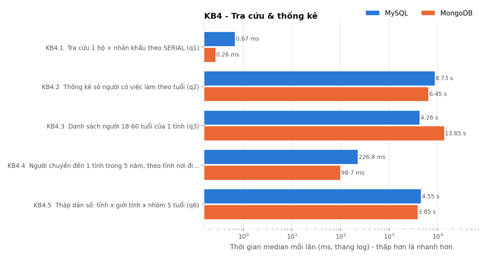
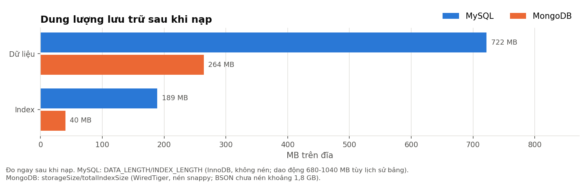
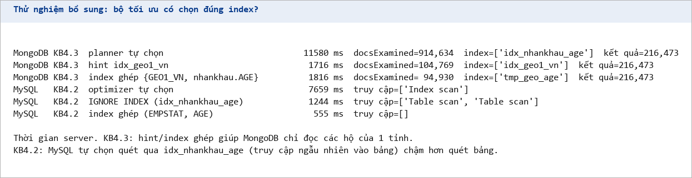

# A5: MongoDB và MySQL với bài toán quản lý nhân khẩu

## 1. Giới thiệu

### 1.1. Bài toán quản lý nhân khẩu

Quản lý nhân khẩu là bài toán quản trị thông tin công dân gắn với hộ gia đình và địa giới hành chính nhiều cấp (Tỉnh/Thành phố → Quận/Huyện → Phường/Xã → Tổ dân phố/Thôn). Một hệ thống quản lý nhân khẩu điển hình gồm bốn nhóm thực thể và nghiệp vụ chính:

- **Nhân khẩu (công dân):** mã định danh cá nhân (số CCCD 12 chữ số), họ tên, ngày sinh, giới tính, quê quán, dân tộc, tôn giáo, nghề nghiệp, trình độ học vấn, nơi thường trú, tình trạng hôn nhân, quan hệ với chủ hộ.
- **Hộ khẩu (sổ hộ khẩu điện tử):** mã hộ, chủ hộ, địa chỉ thường trú (Tỉnh, Huyện, Xã, số nhà/đường) và danh sách thành viên.
- **Tạm trú / tạm vắng:** theo dõi sự di chuyển của công dân (nơi tạm trú, thời hạn, lý do).
- **Lịch sử biến động nhân khẩu:** ghi nhận các sự kiện thay đổi trạng thái như khai sinh, khai tử, tách hộ, nhập hộ, chuyển đi, chuyển đến.

Về mặt dữ liệu, quan hệ cốt lõi là **hộ khẩu – nhân khẩu (1–n)**: mỗi nhân khẩu thuộc đúng một hộ thường trú, mỗi hộ có trung bình 3–4 thành viên. Quan hệ này có hai đặc điểm quyết định cách thiết kế CSDL:

1. **Tính cục bộ cao:** phần lớn thao tác tra cứu và cập nhật diễn ra trên một hộ (xem sổ hộ khẩu, khai sinh, đăng ký kết hôn), nên dữ liệu của một hộ thường được đọc và ghi cùng nhau.
2. **Một số nghiệp vụ trải trên nhiều hộ** (chuyển hộ khẩu, tách hộ, nhập hộ). Các nghiệp vụ này phải thỏa tính nguyên tử: hoặc thực hiện toàn bộ, hoặc không thực hiện gì. Ví dụ, không được phép để một công dân đã bị xóa khỏi hộ cũ nhưng chưa được thêm vào hộ mới.

Khối lượng công việc vì thế mang tính **hỗn hợp**: OLTP (đăng ký, cập nhật cư trú với tần suất cao, mỗi giao dịch nhỏ) kết hợp với OLAP (thống kê dân số, tháp tuổi, di cư theo tỉnh, phải quét toàn bộ dữ liệu). Đây là lý do nên so sánh hai hệ QTCSDL có triết lý thiết kế khác nhau trên cùng bài toán.

### 1.2. Tóm tắt các điểm khác biệt giữa MongoDB và MySQL

| Tiêu chí | MongoDB | MySQL (InnoDB) |
|---|---|---|
| **Mô hình dữ liệu** | Lưu tài liệu (document) dạng BSON (JSON nhị phân) trong các collection. Hỗ trợ nhúng (embed) tài liệu con và mảng, nên quan hệ 1–n có thể biểu diễn trong một document. | Lưu dữ liệu theo dòng và cột trong các bảng quan hệ. Quan hệ 1–n biểu diễn bằng khóa ngoại và được ghép lại khi truy vấn bằng JOIN. |
| **Lược đồ** | Lược đồ linh hoạt (schema-flexible): các document trong cùng collection có thể khác cấu trúc. Có thể ràng buộc lược đồ tùy chọn bằng `$jsonSchema`. | Lược đồ cố định, khai báo bằng DDL. Kiểu dữ liệu, `NOT NULL`, `UNIQUE` và khóa ngoại được kiểm tra khi ghi. Thay đổi lược đồ cần `ALTER TABLE`. |
| **Ngôn ngữ truy vấn** | MongoDB Query Language (MQL) và aggregation pipeline (`$match`, `$unwind`, `$group`, `$lookup`…). | SQL chuẩn: JOIN, GROUP BY/HAVING, truy vấn con, hàm cửa sổ (`ROW_NUMBER()`…), CTE. |
| **Giao dịch (ACID)** | Thao tác trên **một** document luôn nguyên tử. Giao dịch nhiều document được hỗ trợ từ phiên bản 4.0, nhưng **chỉ trên replica set hoặc sharded cluster** và tốn chi phí cao hơn. | ACID đầy đủ cho mọi giao dịch nhiều dòng, nhiều bảng. Có khóa mức dòng, MVCC và 4 mức cô lập (mặc định REPEATABLE READ). |
| **Lưu trữ và nén** | Engine WiredTiger, mặc định nén khối dữ liệu bằng snappy và nén tiền tố cho index. | Engine InnoDB, lưu theo clustered index trên khóa chính. Mặc định không nén (có tùy chọn `ROW_FORMAT=COMPRESSED`). |
| **Index** | B-Tree: index đơn, index ghép, multikey (index trên phần tử của mảng), text, geospatial, TTL. | B-Tree (clustered và secondary), full-text, spatial (R-Tree). Index ghép chỉ gồm các cột **trong cùng một bảng**. |
| **Mở rộng quy mô** | Mở rộng theo chiều ngang (sharding) được tích hợp sẵn. Sao chép dữ liệu bằng replica set, tự động bầu lại node chính khi có sự cố. | Chủ yếu mở rộng theo chiều dọc, kết hợp bản sao chỉ đọc (replication) để tăng khả năng đọc. Phân mảnh ngang cần giải pháp bổ sung (InnoDB Cluster, NDB, Vitess). |
| **Hiệu năng (khái quát)** | Mạnh khi đọc và ghi nguyên một tập hợp dữ liệu liên quan (một document), và khi ghi số lượng lớn. | Mạnh khi truy vấn kết nối, lọc nhiều bảng và trả về tập kết quả lớn có cấu trúc. |
| **Logic phía server** | Không có thủ tục lưu sẵn. Dùng change streams hoặc trigger của Atlas để phản ứng với thay đổi dữ liệu. | Có thủ tục (stored procedure), hàm, trigger, event và view. |
| **Bảo mật** | Xác thực SCRAM (mặc định), x.509; LDAP và Kerberos ở bản Enterprise/Atlas. Phân quyền theo vai trò (RBAC). | Xác thực tích hợp (`caching_sha2_password`); LDAP và Kerberos qua plugin (Enterprise). Phân quyền theo cơ sở dữ liệu, bảng, cột và vai trò. |

Việc lựa chọn giữa MongoDB và MySQL, đặc biệt với dữ liệu lớn, phụ thuộc vào các yếu tố sau:

- **MySQL** tuân thủ ACID đầy đủ, nên phù hợp với các giao dịch phức tạp liên quan nhiều bảng như thương mại điện tử, ngân hàng và tài chính. Lược đồ chặt chẽ kết hợp hệ thống index giúp bộ tối ưu truy vấn (query optimizer) lập kế hoạch thực thi hiệu quả cho các **truy vấn đặc thù (ad-hoc)**. Đây là những truy vấn không định trước, thường do người dùng cuối hoặc nhà phân tích dữ liệu đặt ra khi cần thông tin chưa có sẵn trong báo cáo, và thường phải kết nối nhiều bảng danh mục.
- **MongoDB** là CSDL NoSQL hướng tài liệu, phù hợp với dữ liệu bán cấu trúc hoặc có cấu trúc thay đổi theo thời gian, như mạng xã hội, quản lý nội dung hay IoT. Các thông tin liên quan được lưu cùng nhau trong một document, nên một thao tác đọc có thể lấy toàn bộ hồ sơ mà không cần JOIN. Document tự mô tả cấu trúc của nó: khi cần thêm trường mới, chỉ những document mới cần mang trường đó, không cần cập nhật danh mục hệ thống (catalog) và không cần dừng hệ thống để chạy `ALTER TABLE`. Đổi lại, các ràng buộc toàn vẹn giữa các document (tương tự khóa ngoại) phải do ứng dụng tự bảo đảm.

| Trường hợp sử dụng MongoDB | Trường hợp sử dụng MySQL |
|---|---|
| Phân tích dữ liệu thời gian thực | Nền tảng thương mại điện tử |
| Ứng dụng dữ liệu lớn (Big Data) | Ứng dụng ngân hàng, tài chính |
| Hệ thống quản lý nội dung | Hệ thống quản lý quan hệ khách hàng (CRM) |
| Ứng dụng IoT | Hệ thống hoạch định nguồn lực doanh nghiệp (ERP) |
| Ứng dụng di động cần mở rộng nhanh | Hệ thống nghiệp vụ hành chính cần toàn vẹn dữ liệu |

### 1.3. Giả thuyết cho bài toán quản lý nhân khẩu

Từ các đặc điểm trên, nhóm đặt ra hai giả thuyết để kiểm chứng bằng thực nghiệm:

- **H1 – MySQL phù hợp hơn với các nghiệp vụ hành chính đòi hỏi ACID tuyệt đối** (tách hộ, chuyển hộ khẩu, cập nhật trạng thái pháp lý) và với các truy vấn thống kê kết nối nhiều chiều (ad-hoc OLAP) giữa các bảng.
- **H2 – MongoDB vượt trội khi lưu và tra cứu hồ sơ hộ ở quy mô lớn.** Gom toàn bộ thành viên của hộ (và có thể cả lịch sử biến động) vào một document giúp tăng tốc tra cứu hồ sơ chi tiết, và cho phép bổ sung trường thông tin mới mà không cần thay đổi lược đồ của toàn hệ thống.

Để thấy rõ chênh lệch hiệu năng, dữ liệu thử nghiệm cần đủ lớn so với các mốc quy mô hành chính: 1.000–10.000 nhân khẩu (một phường, xã), khoảng 100.000 (một quận, huyện), từ vài trăm nghìn tới khoảng một triệu (một tỉnh nhỏ hoặc trung bình), và hàng triệu (thành phố lớn như Hà Nội, TP.HCM). Ở quy mô nhỏ, toàn bộ dữ liệu nằm gọn trong bộ nhớ đệm, nên khác biệt giữa hai hệ chủ yếu đến từ độ trễ mạng và chi phí gọi lệnh. Chỉ ở quy mô hàng triệu bản ghi, sự khác biệt về mô hình lưu trữ, index và kế hoạch thực thi mới thể hiện rõ. Vì vậy cần một bộ dữ liệu thật về dân cư, có cấu trúc hộ–người và có quy mô hàng triệu nhân khẩu.

---

## 2. Thiết kế thử nghiệm

### 2.1. Bộ dữ liệu

Nhóm sử dụng **dữ liệu vi mô Tổng điều tra Dân số và Nhà ở Việt Nam 2019** do IPUMS International cung cấp, gồm **1.001.120 hộ** và **3.550.482 nhân khẩu**. Quy mô này tương đương dân số một tỉnh lớn hoặc khoảng một nửa dân số Hà Nội, và trải đủ 63 tỉnh/thành. Tệp CSV gốc ở dạng mỗi dòng là một người, kèm theo thông tin của hộ. Nhóm tách tệp này thành hai tệp hộ và người (`split_ipums_csv.py`).

Ánh xạ từ các thực thể ở mục 1.1 sang dữ liệu:

| Thực thể nghiệp vụ | Dữ liệu tương ứng |
|---|---|
| Hộ khẩu | `hokhau`: `SERIAL` (mã hộ), `PERSONS` (số thành viên), `GEO1_VN`/`GEO2_VN` (tỉnh/huyện), `URBAN`, `OWNERSHIP` |
| Nhân khẩu | `nhankhau`: (`SERIAL`, `PERNUM`) là định danh, cùng `RELATE` (quan hệ với chủ hộ), `AGE`, `SEX`, `MARST`, `ETHNICVN`, `RELIGION`, `EDATTAIN`, `EMPSTAT`… |
| Tạm trú / di cư | `MIGRATE5` (tình trạng di cư 5 năm), `GEOMIG1_5` (tỉnh nơi ở 5 năm trước), `MIGCAUSE` (lý do di cư) |
| Lịch sử biến động | Bảng/collection `biendong_cutru` do nhóm bổ sung, ghi các loại sự kiện `DANG_KY_HO_MOI`, `KHAI_SINH`, `CHUYEN_DI`, `CHUYEN_DEN`, `TACH_HO`, `XOA_DANG_KY` |

Do là dữ liệu điều tra đã ẩn danh, bộ dữ liệu không có họ tên và số CCCD. Các thuộc tính là **mã số** (cần codebook để giải nghĩa), nên các tiêu chí liên quan tìm kiếm văn bản (full-text) không được đánh giá.

### 2.2. Thiết kế lược đồ trên hai hệ

**MySQL (chuẩn hóa):** hai bảng `hokhau` (khóa chính `SERIAL`) và `nhankhau` (khóa chính ghép `(SERIAL, PERNUM)`, khóa ngoại `SERIAL → hokhau`). Vì InnoDB tổ chức bảng theo clustered index trên khóa chính, các nhân khẩu cùng hộ được lưu liền nhau trên đĩa.

**MongoDB (nhúng):** một collection `hokhau`, mỗi document là một sổ hộ khẩu, trong đó các nhân khẩu là mảng nhúng:

```js
{ _id: SERIAL, SERIAL, GEO1_VN, GEO2_VN, PERSONS, URBAN, ...,
  nhankhau: [ { PERNUM: 1, RELATE: 1, AGE: 45, SEX: 1, EMPSTAT: 1, ... }, ... ] }
```

Mô hình nhúng được chọn vì quan hệ hộ–người là quan hệ "chứa" và có số phần tử nhỏ, nên không có nguy cơ vượt giới hạn 16 MB của một document. `biendong_cutru` là collection riêng vì số sự kiện tăng không giới hạn theo thời gian.

**Index tương đương trên hai hệ:**

| Mục đích | MySQL | MongoDB |
|---|---|---|
| Tra hộ theo mã | PK `hokhau(SERIAL)` | `_id` |
| Lọc theo tỉnh | `idx_hokhau_geo1_vn (GEO1_VN)` | `idx_geo1_vn {GEO1_VN}` |
| Lọc theo tuổi | `idx_nhankhau_age (AGE)` | `idx_nhankhau_age {nhankhau.AGE}` (multikey) |
| Báo cáo di cư | `idx_nhankhau_migrate5 (MIGRATE5)` | `idx_nhankhau_migrate5 {nhankhau.MIGRATE5}` (multikey) |
| Lịch sử theo hộ | `biendong_cutru.idx_serial` | `biendong_cutru.idx_serial` |

### 2.3. Môi trường và phương pháp đo

- **Phần cứng, phần mềm:** một máy Windows 11; MySQL 8.0.46 (InnoDB) và MongoDB 8.0.3 (WiredTiger, chế độ standalone). Bộ nhớ đệm của hai hệ được đặt bằng nhau: `innodb_buffer_pool_size` = WiredTiger cache = 2 GB.
- **Kịch bản:** 12 kịch bản nghiệp vụ, chia thành 4 nhóm: thu thập (KB1), cập nhật (KB2), đăng ký cư trú (KB3), tra cứu và thống kê (KB4). Mỗi kịch bản có một bản MySQL (`a5/mysql/*.sql`) và một bản MongoDB (`a5/mongodb/*.js`) thực hiện **cùng một nghiệp vụ**. Ở MySQL, mỗi nghiệp vụ cư trú là một giao dịch (`START TRANSACTION … COMMIT`) có khóa dòng `SELECT … FOR UPDATE`.
- **Đo:** công cụ `a5/bench/bench.py` (Python, pymysql/pymongo) chạy mỗi kịch bản 3–100 lần sau một lần chạy làm nóng không tính giờ, và ghi lại median, p95, min, max. Thời gian đo từ phía client, gồm cả thời gian nhận hết kết quả. Các truy vấn đọc chạy trước truy vấn cập nhật hàng loạt để tránh ảnh hưởng tới bộ nhớ đệm. Với mỗi truy vấn đọc, công cụ **tự đối chiếu kết quả** giữa hai hệ, và lưu kế hoạch thực thi (`EXPLAIN ANALYZE` của MySQL, `explain("executionStats")` của MongoDB) để phân tích.

---

## 3. Kết quả và phân tích

### 3.1. Bảng tổng hợp

| Nhóm | Kịch bản | MySQL | MongoDB | Nhanh hơn |
|---|---|---|---|---|
| Thu thập | KB1.1 Nạp toàn bộ dữ liệu | 70,3 s (+ 29,6 s tạo index) | 69,5 s (+ 12,6 s tạo index) | Gần bằng; tạo index MongoDB nhanh ×2,3 |
| | KB1.2 Đăng ký hộ mới (1 hộ + 4 người + ghi biến động) | 4,49 ms | 3,48 ms | MongoDB ×1,3 |
| Cập nhật | KB2.1 Đăng ký kết hôn (1 người) | 3,27 ms | 1,71 ms | MongoDB ×1,9 |
| | KB2.2 Tăng tuổi toàn bộ dân 1 tỉnh (373 nghìn người) | 13,42 s | 4,50 s | MongoDB ×3,0 |
| Cư trú | KB3.1 Khai sinh | 9,14 ms | 5,56 ms | MongoDB ×1,6 |
| | KB3.2 Chuyển hộ khẩu | 9,37 ms | 9,87 ms | Gần bằng (MySQL ×1,1) |
| | KB3.3 Tách hộ | 8,34 ms | 10,29 ms | MySQL ×1,2 |
| | KB3.4 Xóa đăng ký thường trú | 7,73 ms | 5,80 ms | MongoDB ×1,3 |
| Tra cứu | KB4.1 Tra cứu 1 hộ theo mã | 0,67 ms | 0,26 ms | MongoDB ×2,5 |
| | KB4.2 Số người có việc làm theo tuổi (cả nước) | 8,73 s | 6,45 s | MongoDB ×1,4 |
| | KB4.3 Danh sách người 18–60 tuổi của Hà Nội (216.473 dòng) | 4,26 s | 13,65 s | **MySQL ×3,2** |
| | KB4.4 Người nhập cư vào Hà Nội theo tỉnh nơi đi | 227 ms | 99 ms | MongoDB ×2,3 |
| | KB4.5 Tháp dân số: tỉnh × giới tính × nhóm 5 tuổi | 4,55 s | 3,85 s | MongoDB ×1,2 |

*Giá trị là median. Cả năm truy vấn KB4 cho kết quả trùng khớp trên hai hệ.*



### 3.2. Thao tác trên một hộ: lợi thế của mô hình nhúng

Ở các kịch bản tra cứu một hộ (KB4.1), khai sinh (KB3.1), xóa đăng ký (KB3.4) và đăng ký kết hôn (KB2.1), MongoDB chỉ đọc hoặc ghi **một document**. MySQL phải JOIN hai bảng, hoặc mở giao dịch, khóa dòng của hộ (`SELECT … FOR UPDATE`) rồi thực hiện 3–4 câu lệnh. Kết quả là MongoDB nhanh hơn 1,3–2,5 lần.

Ngoài tốc độ, các nghiệp vụ này còn **nguyên tử sẵn** trên MongoDB mà không cần giao dịch. Ví dụ, khai sinh được viết thành một lệnh `findOneAndUpdate` với pipeline update: trong cùng một thao tác, lệnh tự tính `PERNUM = max + 1`, nối trẻ mới sinh vào mảng `nhankhau` và tăng `PERSONS`. Điều này phù hợp với giả thuyết H2.

### 3.3. Nghiệp vụ nhiều hộ: lợi thế của giao dịch quan hệ

Chuyển hộ khẩu (KB3.2) và tách hộ (KB3.3) sửa **hai document**. MongoDB phải đọc document về client, xử lý mảng rồi ghi lại từng document. MySQL thực hiện toàn bộ trên server bằng `INSERT … SELECT` và hàm cửa sổ `ROW_NUMBER()` để đánh lại số thứ tự thành viên. Ở các kịch bản này, hai hệ ngang nhau, MySQL nhỉnh hơn (×1,1–1,2).

Cần lưu ý rằng MongoDB được đo ở chế độ standalone, **không có giao dịch nhiều document**. Như vậy phép đo đang có lợi cho MongoDB. Khi chạy trên replica set với `session.withTransaction()`, MongoDB phải chịu thêm chi phí của giao dịch và oplog, nên dự kiến sẽ chậm hơn nữa. Kết quả này phù hợp với giả thuyết H1: giao dịch nhiều bảng là chức năng cốt lõi, có sẵn và đã được tối ưu của mô hình quan hệ, trong khi với MongoDB đó là chức năng bổ sung và có điều kiện.



### 3.4. Cập nhật hàng loạt

Với KB2.2 (tăng tuổi cho 373 nghìn người ở Hà Nội), MongoDB nhanh gấp 3 lần. MongoDB chỉ phải cập nhật **105 nghìn document hộ**, mỗi document một lần ghi. MySQL phải chạy `UPDATE … JOIN` để ghi **373 nghìn dòng**, đồng thời duy trì index `AGE` và ghi binlog. Kết quả minh họa nhận định trong chương 2 của bài giảng: index tăng tốc thao tác đọc nhưng làm tăng chi phí ghi. Ngoài ra, mô hình nhúng còn giảm số đơn vị phải ghi đi khoảng 3,5 lần.

### 3.5. Tra cứu và thống kê

**Truy vấn trả về danh sách dài (KB4.3): MySQL nhanh hơn 3,2 lần.** Theo `EXPLAIN ANALYZE`, MySQL chỉ mất **475 ms trên server**. Kế hoạch thực thi là: dùng `idx_hokhau_geo1_vn` để tìm các hộ của Hà Nội, rồi với mỗi hộ, tra theo tiền tố khóa chính `(SERIAL, …)` để lấy các nhân khẩu. Phần lớn trong 4,26 s còn lại là thời gian client giải mã 216 nghìn dòng. MongoDB mất 9,9 s trên server, vì bộ lập kế hoạch truy vấn (query planner) **chọn sai index** (phân tích ở mục 4).

**Thống kê quét toàn bộ dữ liệu (KB4.2, KB4.5): MongoDB nhỉnh hơn ×1,2–1,4.** Cả hai hệ đều phải đọc toàn bộ 3,55 triệu người. MongoDB đọc tuần tự các document hộ (thông tin hộ và người nằm sẵn cạnh nhau) rồi dùng `$unwind` để tách từng người. MySQL phải nối 1 triệu hộ với 3,55 triệu người bằng nested-loop join.

**Báo cáo di cư (KB4.4): MongoDB nhanh hơn 2,3 lần.** Cả hai hệ đều dùng index `MIGRATE5`, nhưng MongoDB không cần bước JOIN ngược về bảng hộ để lọc theo tỉnh, vì `GEO1_VN` nằm ngay trong document.



### 3.6. Nạp dữ liệu và dung lượng lưu trữ

Thời gian nạp toàn bộ dữ liệu gần như bằng nhau (khoảng 70 s). MongoDB tạo index nhanh hơn 2,3 lần, vì index nhỏ hơn (40 MB so với 189 MB) nhờ nén tiền tố. Sau khi nạp, MongoDB chiếm **264 MB dữ liệu + 40 MB index**, MySQL chiếm **722 MB + 189 MB**. Như vậy MongoDB tiết kiệm khoảng 3 lần dung lượng đĩa nhờ WiredTiger nén bằng snappy, mặc dù nếu không nén thì dữ liệu BSON lên tới khoảng 1,8 GB, do tên trường bị lặp lại trong từng document. Kích thước của InnoDB không ổn định: với cùng một bộ dữ liệu, kích thước dao động 680–1.040 MB tùy lịch sử thao tác trên bảng (chạy `OPTIMIZE TABLE` thậm chí còn làm bảng lớn hơn). Vì vậy chỉ nên so sánh dung lượng theo **bậc độ lớn**.



### 3.7. Ràng buộc toàn vẹn và logic nghiệp vụ (đánh giá định tính)

MySQL bảo đảm toàn vẹn ở mức lược đồ thông qua khóa ngoại `nhankhau → hokhau`, `NOT NULL` và strict mode: không thể tồn tại một nhân khẩu không thuộc hộ nào. Ở MongoDB, ràng buộc này được bảo đảm nhờ cấu trúc nhúng, nhưng các bất biến khác do ứng dụng tự bảo đảm, chẳng hạn `PERSONS` phải bằng số phần tử của mảng `nhankhau`, hay `biendong_cutru.SERIAL` phải trỏ tới một hộ có thật. Có thể giảm rủi ro bằng `$jsonSchema`. Thủ tục, trigger và event (chương 3) chỉ có ở MySQL. Trên MongoDB, việc tự động ghi lịch sử biến động phải dùng change streams hoặc trigger của Atlas.

---

## 4. Bộ tối ưu truy vấn và việc chọn index

Thử nghiệm bổ sung (`a5/bench/index_choice.py`, đo thời gian trên server) cho thấy **cả hai bộ tối ưu đều có trường hợp chọn kế hoạch kém**:

| Truy vấn | Bộ tối ưu tự chọn | Điều chỉnh | Kết quả |
|---|---|---|---|
| KB4.3 MongoDB | Index multikey `nhankhau.AGE`: đọc 914.634 document, 11,6 s | `hint` vào `idx_geo1_vn`: đọc 104.769 document | **1,7 s** (×6,8) |
| | | Index ghép `{GEO1_VN, nhankhau.AGE}`: đọc 94.930 document | **1,8 s** (×6,4) |
| KB4.2 MySQL | Quét toàn bộ index `AGE`, rồi tra ngược vào bảng cho từng dòng: 7,7 s | `IGNORE INDEX`, quét thẳng bảng | **1,2 s** (×6,2) |
| | | Index ghép phủ (covering) `(EMPSTAT, AGE)` | **0,56 s** (×14) |

**MongoDB – KB4.3.** Với index multikey, điều kiện khoảng `{"nhankhau.AGE": {$gte: 18, $lte: 60}}` **không thể dùng để thu hẹp phạm vi quét** như với cột thường. Lý do là hai vế `$gte` và `$lte` có thể được thỏa bởi hai người *khác nhau* trong cùng một hộ, nên planner chỉ giới hạn được một đầu của khoảng. Kết quả là phải đọc gần 0,9 triệu document. Có ba cách khắc phục: dùng `$elemMatch` để buộc cả hai điều kiện áp dụng trên cùng một phần tử, chỉ định index bằng `hint`, hoặc tạo index ghép `{GEO1_VN, nhankhau.AGE}`. Đáng chú ý, index ghép kiểu này (giữa một thuộc tính của hộ và một thuộc tính của người) **không thể tạo trên MySQL**, vì hai cột nằm ở hai bảng khác nhau. Đây là một lợi thế cụ thể của mô hình nhúng.

**MySQL – KB4.2.** Bộ tối ưu chọn index `AGE` để tránh phải sắp xếp cho `GROUP BY AGE`, nhưng cái giá là 3,55 triệu lần truy cập ngẫu nhiên vào clustered index để lấy cột `EMPSTAT`. Index ghép phủ `(EMPSTAT, AGE)` cho phép trả lời truy vấn chỉ từ index, không cần đọc bảng.

Kết quả này minh họa nội dung chương 8: bộ tối ưu chọn kế hoạch dựa trên **ước lượng chi phí**, mà ước lượng có thể sai. Vì vậy, khi đánh giá hiệu năng, cần đọc kế hoạch thực thi chứ không chỉ so sánh thời gian chạy. Trong thử nghiệm này, chênh lệch do chọn index (6–14 lần) **lớn hơn** chênh lệch giữa hai hệ QTCSDL (1,2–3,2 lần).



---

## 5. Kết luận

| Nhóm nghiệp vụ | Hệ phù hợp hơn | Lý do |
|---|---|---|
| Thao tác trên một hộ (tra cứu, khai sinh, kết hôn, xóa đăng ký) | **MongoDB** | Một document, nguyên tử sẵn, nhanh hơn 1,3–2,5 lần |
| Nghiệp vụ nhiều hộ cần ACID (chuyển hộ khẩu, tách hộ) | **MySQL** | Giao dịch nhiều bảng là chức năng cốt lõi, xử lý trọn trên server, ngang hoặc nhanh hơn ngay cả khi MongoDB chạy không có giao dịch |
| Cập nhật hàng loạt | **MongoDB** | Số đơn vị phải ghi ít hơn khoảng 3,5 lần |
| Thống kê, báo cáo | Tương đương | Cùng bậc thời gian; yếu tố quyết định là index và kế hoạch thực thi |
| Truy vấn trả về danh sách lớn | **MySQL** | Kế hoạch thực thi ổn định hơn với điều kiện khoảng trên cột thường |
| Lưu trữ | **MongoDB** | Dung lượng ít hơn khoảng 3 lần nhờ nén |

Các giả thuyết ở mục 1.3 được xác nhận một phần. **H2 đúng** với các thao tác trên từng hộ và với cập nhật hàng loạt. **H1 đúng** với các nghiệp vụ nhiều hộ. Tuy nhiên, giả thuyết "MySQL mạnh hơn ở thống kê OLAP" **không được xác nhận**: ở quy mô 3,55 triệu nhân khẩu, hai hệ cho thời gian cùng bậc, và lựa chọn index có ảnh hưởng lớn hơn nhiều so với lựa chọn hệ QTCSDL.

Không hệ nào vượt trội tuyệt đối. Với một hệ thống đăng ký cư trú thực tế, nơi tính đúng đắn của các giao dịch thay đổi hộ khẩu là yêu cầu bắt buộc, **MySQL là lựa chọn an toàn hơn cho phần nghiệp vụ lõi**. MongoDB phù hợp cho phần tra cứu hồ sơ hộ, cho kho báo cáo, hoặc khi dữ liệu mỗi hộ có cấu trúc thay đổi theo thời gian. Một kiến trúc kết hợp cả hai (MySQL làm nguồn dữ liệu gốc, MongoDB làm bản sao phục vụ tra cứu) là hướng đáng cân nhắc.

## 6. Hạn chế và hướng phát triển

1. **MongoDB chưa chạy giao dịch:** ở chế độ standalone, các kịch bản KB1.2 và KB3.x của MongoDB chạy không có giao dịch. Cần chuyển sang replica set 1 node rồi đo lại.
2. **Chưa đo truy cập đồng thời** (chương 4: mức cô lập, khóa), ví dụ 10–50 cán bộ cùng đăng ký hoặc chuyển hộ. Đây là tiêu chí quan trọng nhất còn thiếu đối với một hệ OLTP.
3. **Log ghi không cân bằng:** MySQL bật binlog (mặc định của MySQL 8), trong khi MongoDB standalone không có oplog. Điều này có lợi cho MongoDB ở các kịch bản ghi, nhất là KB2.2.
4. **Chỉ đo ở một quy mô** (3,55 triệu nhân khẩu). Chưa đo ở các mốc nhỏ hơn đã nêu ở mục 1.3 (một xã, một huyện, một tỉnh), cũng như chưa thử sharding hoặc replication ở quy mô lớn hơn.
5. **Đo từ phía client:** thời gian đo gồm cả chi phí giải mã kết quả trong Python (pymysql viết thuần Python, còn bson có phần viết bằng C), nên ảnh hưởng tới các truy vấn trả về nhiều dòng như KB4.3. Thời gian thuần trên server được lưu trong `results/explain_*/`.
6. **Chỉ một máy, một lượt đo.** Chưa lặp lại thí nghiệm vào thời điểm khác để đánh giá độ ổn định.

## Tài liệu tham khảo

1. Viblo – So sánh MongoDB và MySQL: https://viblo.asia/p/so-sanh-mongodb-va-mysql-Qbq5QWWEZD8
2. AWS – Sự khác biệt giữa MongoDB và MySQL: https://aws.amazon.com/vi/compare/the-difference-between-mongodb-vs-mysql/
3. GeeksforGeeks – MongoDB vs MySQL: https://www.geeksforgeeks.org/mongodb/mongodb-vs-mysql/
4. Bài giảng Hệ quản trị CSDL, Khoa CNTT: C_1, C_2_1, C_2_2, C_3, C_4, C_8.
5. Minnesota Population Center. *IPUMS International*, Vietnam 2019 Census microdata.
6. Tài liệu MongoDB 8.0 (Multikey Indexes, Transactions) và tài liệu MySQL 8.0 Reference Manual (InnoDB, EXPLAIN ANALYZE).
